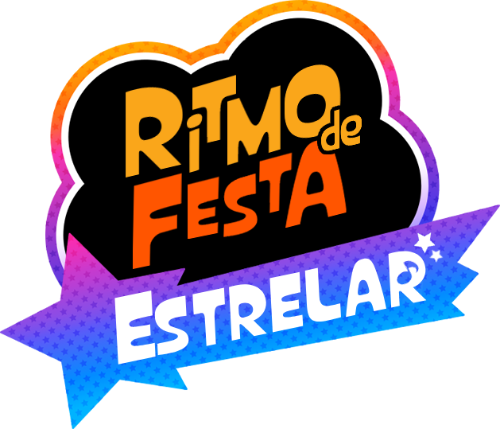

<h1>Ritmo de Festa Estrelar</h1>

Uma localização em Português Brasileiro não oficial para o jogo Rhythm Heaven Groove para Nintendo Switch.
<h1>Sobre</h1>
<strong>Ritmo de Festa Estrelar</strong> é uma localização feita por fãs de Rhythm Heaven Groove. A tradução disponibiliza textos, dublagem e gráficos totalmente localizados em PT-BR.

<h1>Instalação</h1>

# Créditos
## Tradutores
- LeonVic
- Pseudo Polo
- Ovite
- Lorenzowo
- Menino David (Gráficos)

## Adaptação de Letras
- LeonVic
- Neko Belmont
- Brisabella
- Adachi Holmes
- LittyFairyFox
- Hakata932

## Elenco de Dublagem
- Luna Pedroso
- Pedro Hanma
- Alexandre Aknaxis
- Lucas Candido
- Pedro Hanma
- Dantezinn
- JotaDubs
- Neko Belmont
- LeonVic
- Mr.Kimo
- Nick_DSP
- Eddy Winchester
- Sagachi Belmont

## Elenco de Cantores
- Majuh Bandeira
- Maia Penélope
- Ana Cintra
- Neko Belmont
- TheSerket
- Sagachi Belmont
- Charlie Lee
